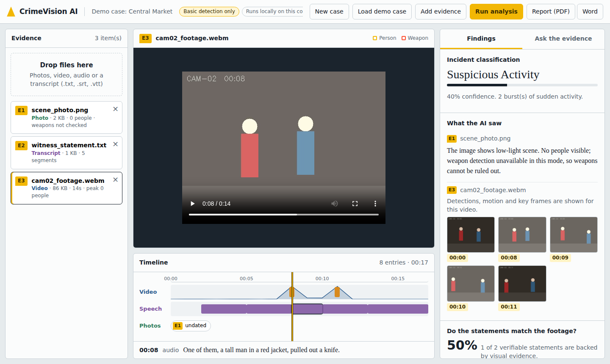

# CrimeVision AI

**Intelligent Multimodal Forensic Analysis Platform**

🚀 **[Launch the live Streamlit app](https://crimevision-ai-mr9fsp2m6eraas5ufgakyq.streamlit.app/)**

CrimeVision AI is a web application that helps investigators analyse crime-scene evidence. Upload **photos**, **video footage**, **audio** or **transcripts**, and the platform detects people and weapon-class objects, flags forensic indicators, aligns everything on a single timeline, classifies the incident, checks witness statements against what the footage shows, lets you ask questions about the evidence, and produces a downloadable report.

> **Privacy note:** Local analysis runs on your computer. If you enable cloud AI features (such as Groq-backed chat or cloud vision), relevant prompts and supported image content may be sent to the configured provider for processing. Do not upload sensitive real-world evidence unless you are authorised to do so.
> Results are AI-generated leads for a human investigator, not confirmed findings. Always verify results against the original evidence.



## Features

- **Image analysis**
  - RT-DETR detects people, knives, bats and scissors and draws boxes on the image.
  - CLIP identifies the scene type and flags possible forensic indicators: firearm, knife, blood, person on the ground, broken glass, forced entry, ransacked room, fire damage, vehicle collision, vandalism, drugs and cash.
  - A short two-line summary is written for every image.
- **Video analysis**
  - Frames are sampled once per second and resized while keeping the aspect ratio.
  - People and weapons are detected in every sampled frame, and sudden activity is measured.
  - The most informative key frames are annotated and checked for forensic indicators.
  - The incident is classified (for example Assault, Armed Assault, Suspicious Activity, No Incident).
- **Audio and transcripts**
  - Whisper transcribes speech with timestamps in English, Hindi, Telugu and French.
  - Text transcripts (`.txt`, `.srt`, `.vtt`) are also accepted.
  - Who, where and when facts are extracted.
- **Fusion and intelligence**
  - Photos, video and speech are merged on one chronological timeline.
  - Each spoken statement is marked as corroborated, not supported, or can't verify, based on the footage.
  - Three alternative scenario hypotheses are generated, each with confidence, supporting evidence and gaps.
- **Evidence chat**
  - Ask questions in plain language, such as "What happened at 00:08?".
  - Answers come only from the analysed evidence and cite timestamps. If the evidence does not say, the app says so.
- **Reports**
  - Download a PDF or Word report with annotated images, key frames, timeline, facts, statement checks and scenarios.
- **Case management**
  - Create cases, add or remove individual evidence files, and reopen your last case after a refresh.

## How it works

```
Upload evidence ──> Image / Audio / Video analysis ──> Fusion (timeline, consistency, scenarios) ──> Chat + Report
```

| Part | Technology |
|------|-----------|
| Object detection | RT-DETR (`PekingU/rtdetr_r50vd`) |
| Scene and forensic indicators | CLIP (`openai/clip-vit-base-patch32`) |
| Speech to text | Whisper (`openai/whisper-base`), Librosa, SoundFile |
| Video processing | OpenCV |
| Backend | Python, Flask, Flask-CORS |
| Reports | ReportLab (PDF), python-docx (Word), Matplotlib (charts) |
| Interface | HTML, CSS and JavaScript dashboard |
| Tests | Pytest |

If the AI models are not installed, the app still runs in a basic mode: it detects people, measures motion and reads transcripts. In that mode weapons are reported as **not checked**, never as absent.

## Requirements

- Windows, macOS or Linux
- Python 3.10, 3.11 or 3.12
- About 3 GB of disk space for the AI models, downloaded on first use
- 8 GB of RAM or more recommended. A GPU is optional; without one, video analysis is slower.
- `ffmpeg` on your PATH if you want to use `.m4a` or `.mp3` audio

## Installation

### Windows (easiest)

1. Install Python from python.org and tick **Add Python to PATH**.
2. Double-click `setup_windows.bat`. Answer **Y** to install the AI models.
3. Double-click `start_windows.bat`. The app opens at http://localhost:5000.

### Manual

```bash
python -m venv venv
venv\Scripts\activate              # macOS/Linux: source venv/bin/activate
pip install -r requirements-core.txt
pip install -r requirements-ai.txt # AI models
python -m backend.app
```

Then open http://localhost:5000. Settings live in `.env` (copy `.env.example` to `.env`). The first analysis is slow while the models download.

## Streamlit version

The repository includes a Streamlit interface in `streamlit_app.py`. The root `requirements.txt` contains the lightweight dependencies intended for Streamlit Community Cloud.

### Run locally

```bash
python -m pip install -r requirements.txt
python -m streamlit run streamlit_app.py
```

### Deploy on Streamlit Community Cloud

1. Open [Streamlit Community Cloud](https://share.streamlit.io/) and connect your GitHub account.
2. Create an app from this repository, select the `main` branch, and set **Main file path** to `streamlit_app.py`.
3. Choose Python 3.11 in the advanced settings if prompted.
4. Under the app's **Settings → Secrets**, add your Groq settings if you want cloud-backed AI responses:

   ```toml
   GROQ_API_KEY = "your_actual_groq_api_key"
   GROQ_MODEL = "llama-3.3-70b-versatile"
   GROQ_TEMPERATURE = "0.15"
   CLOUD_VISION = "true"
   ```

   Create/manage a Groq key at [Groq Console](https://console.groq.com/keys). Keep it in Streamlit Secrets or a local `.env` file—**never commit the real key to GitHub**. The committed `.env.example` must contain placeholders only.

5. After pushing changes to GitHub, Streamlit Community Cloud normally redeploys the app automatically. Check the app dashboard/logs if deployment fails.

### Local environment variables

For local development, create a `.env` file in the project root with your own key:

```dotenv
GROQ_API_KEY=your_actual_groq_api_key
GROQ_MODEL=llama-3.3-70b-versatile
GROQ_TEMPERATURE=0.15
CLOUD_VISION=true
USE_ML_MODELS=true
```

Install `requirements-ai.txt` locally if you want to try the heavier local AI models. Hosted environments may use a lightweight/basic analysis mode because of memory and CPU limits. Cloud-backed AI features depend on a valid key, network access, and provider availability.

## How to use

1. Click **Load demo case** to try the app, or click **New case** and then **Add evidence** to upload your own photos, videos, audio or transcripts.
2. Click **Run analysis**.
3. Click evidence on the left to view it. Boxes mark detected people and weapon-class objects.
4. Click the timeline to jump the video to that moment.
5. Read **Findings** for the incident type, what the AI saw, statement checks, facts and scenarios.
6. Open **Ask the evidence** to ask questions.
7. Click **Report (PDF)** or **Word** to download the report.
8. Click the **×** on an evidence item to remove it.

## Project structure

```
crimevision-ai/
├── backend/
│   ├── app.py                  Flask server and blueprint registration
│   ├── config.py               Settings, paths and model names
│   ├── requirements.txt        Pinned dependencies
│   ├── routes/                 upload, processing, audio, video and chat APIs
│   ├── services/               vision, audio, video, fusion, chat and report logic
│   └── utils/                  logging, model loading, session storage
├── frontend/                   Dashboard (evidence panel, viewport, timeline, findings, chat)
├── streamlit_app.py            Streamlit interface (same analysis engine)
├── requirements.txt            Light install used by Streamlit Cloud
├── .streamlit/config.toml      Streamlit theme and upload limit
├── tests/                      Pytest unit and integration tests
├── docs/screenshots/
├── requirements-core.txt       Light install
├── requirements-ai.txt         AI model packages
├── setup_windows.bat           One-click Windows setup
├── start_windows.bat           One-click Windows start
├── .env.example
└── README.md
```

## API reference

All routes start with `/api`.

| Method | Route | Purpose |
|--------|-------|---------|
| GET | `/health` | Server status and loaded models |
| POST | `/sessions` | Create a case |
| GET | `/sessions`, `/sessions/<id>` | List or open cases |
| DELETE | `/sessions/<id>` | Delete a case |
| DELETE | `/sessions/<id>/files/<file_id>` | Remove one evidence file |
| POST | `/upload` | Upload files (multipart field `files`) |
| GET | `/files/<id>/<name>` | Serve an evidence file |
| POST | `/process/<id>` | Run the full analysis |
| GET | `/process/<id>/result` | Fused results |
| POST | `/images/<id>/analyze` | Analyse images only |
| POST | `/audio/<id>/analyze` | Analyse audio and transcripts only |
| GET | `/audio/<id>/transcript` | Transcript segments and facts |
| POST | `/video/<id>/analyze` | Analyse video only |
| GET | `/video/<id>/timeline` | Video events and incident type |
| POST | `/chat/<id>` | Ask a question about the evidence |
| GET, DELETE | `/chat/<id>/history` | Read or clear chat |
| GET | `/report/<id>?format=pdf` or `docx` | Download the report |
| POST | `/demo` | Create the demo case |

## Tests

```bash
pip install pytest
pytest -q
```

## Limitations

- RT-DETR is trained on common objects, so it detects knives and bats but **not firearms**. Firearms are only flagged by CLIP as possible indicators, which can be wrong.
- Indicator tags and scenario hypotheses are leads, not proof. A human must verify them against the original evidence.
- Analysis runs while you wait, so keep video clips short (under about a minute) for best results.
- There is no login. Run it on your own computer and do not expose it to the internet with real evidence.
